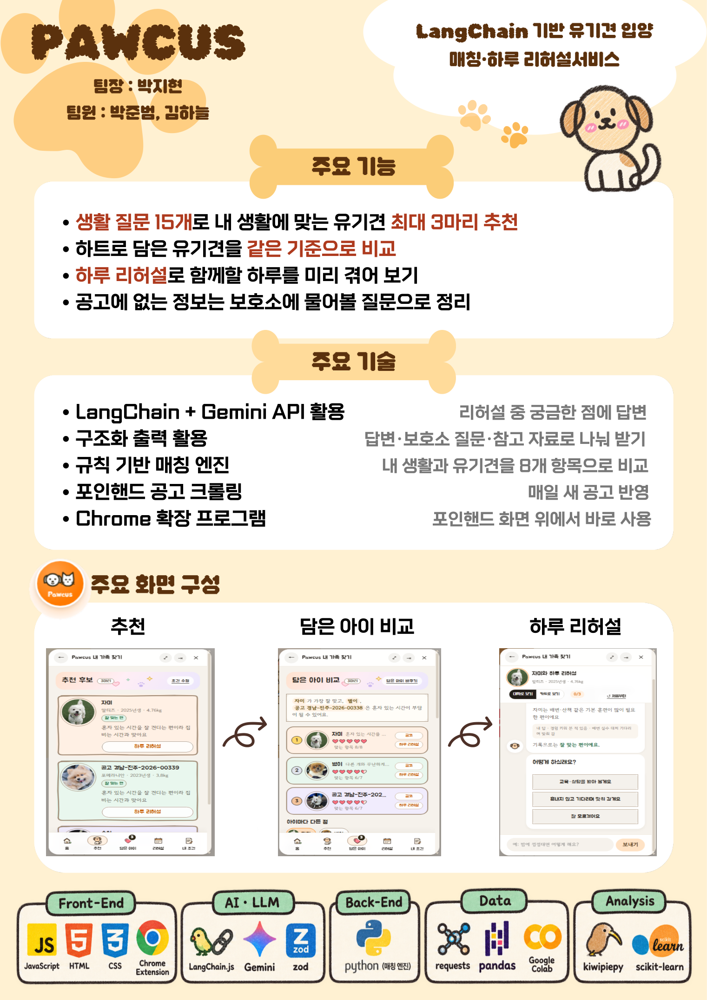
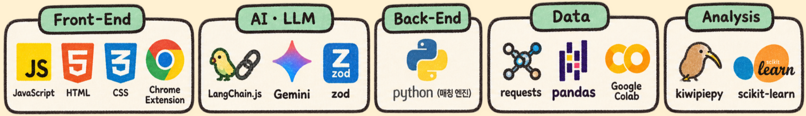
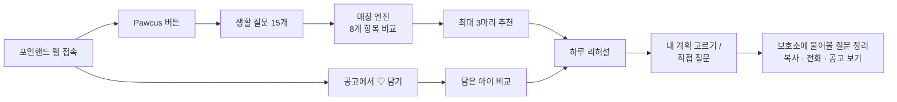
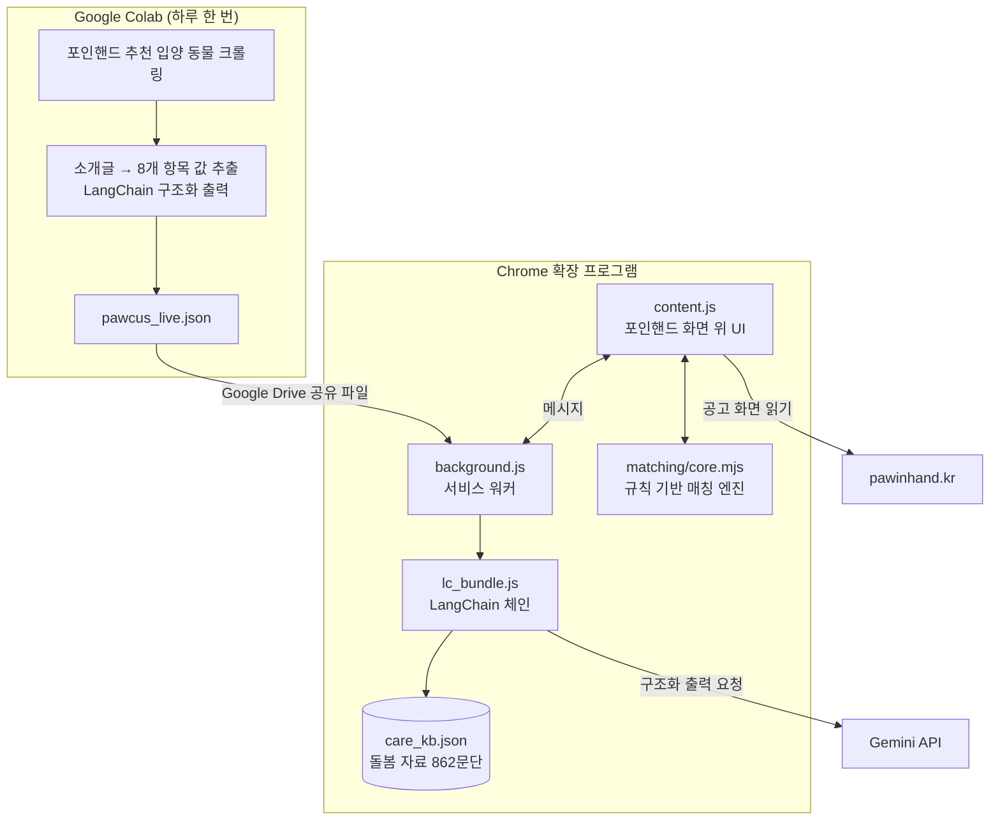
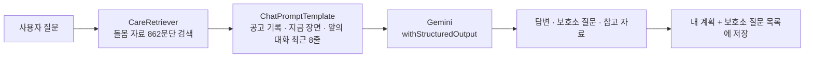
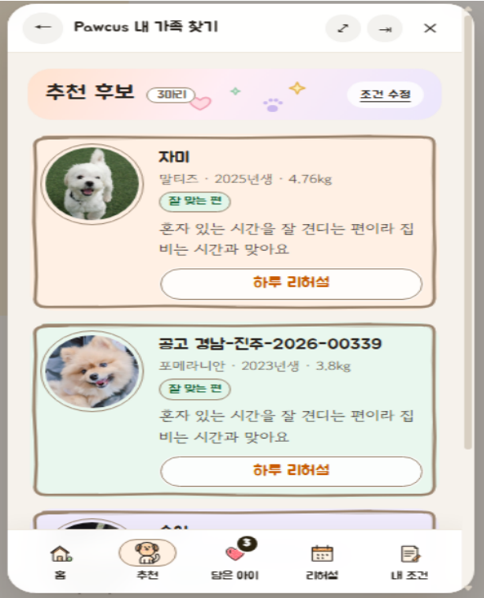
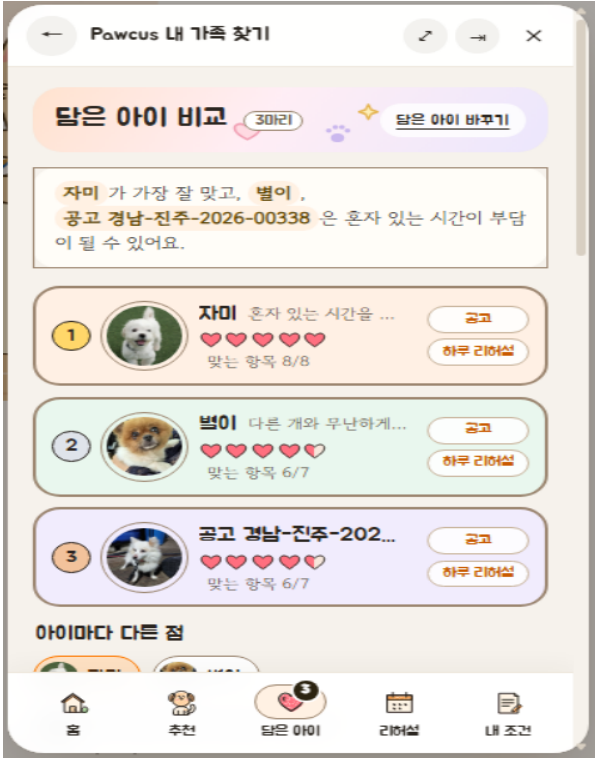
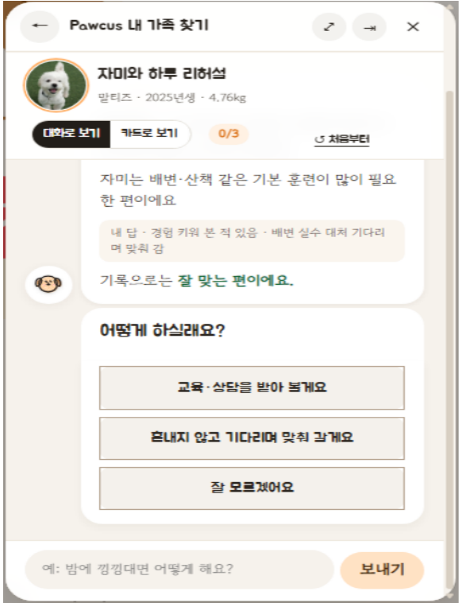

# 🐾 Pawcus — LangChain 기반 유기견 입양 매칭·하루 리허설 서비스

> **팀명 : 포커스(Pawcus)** · Paw(동물의 발) + Focus(집중)
> 지역산업연계 데이터 분석과정 핵심 프로젝트 · 2026.09.02 ~ 2026.10.16

<p align="center">
  
</p>

<br>

## 📌 목차

1. [프로젝트 개요](#1-프로젝트-개요)
2. [주요 기능](#2-주요-기능)
3. [개발 환경](#3-개발-환경)
4. [서비스 흐름](#4-서비스-흐름)
5. [서비스 아키텍처](#5-서비스-아키텍처)
6. [데이터 구성](#6-데이터-구성)
7. [데이터 분석](#7-데이터-분석)
8. [매칭 엔진과 LangChain 리허설](#8-매칭-엔진과-langchain-리허설)
9. [화면 구성](#9-화면-구성)
10. [트러블슈팅](#10-트러블슈팅)
11. [한계와 확장 방향](#11-한계와-확장-방향)
12. [팀원 역할](#12-팀원-역할)
13. [시연 영상](#13-시연-영상)
14. [설치 방법](#14-설치-방법)
15. [참고 문헌](#15-참고-문헌)

<br>

## 1. 프로젝트 개요

**주제 : 포인핸드 웹 위에서 동작하는 유기견 입양 매칭·하루 리허설 Chrome 확장 프로그램**

- 1년 안에 반려동물을 맞을 사람의 **88.3%** 가 유기동물 입양을 고려하지만, 실제로 보호시설에서 입양한 사람은 **8.8%** 입니다. *(농림축산식품부, 2025 동물복지에 대한 국민의식조사)*
- 처음에는 입양 절차 정보가 부족해서 망설인다고 보았습니다. 그런데 포인핸드 고민상담과 블로그를 분석해 보니, 절차는 직접 해 보면 해결됐습니다. 입양 뒤까지 남는 고민은 **"이 개가 내 생활과 맞을까"** 였습니다.
- 그래서 Pawcus는 내 생활과 실제 공고의 유기견을 같은 기준으로 비교합니다. 함께 사는 하루를 미리 겪어 보게 하고, 공고로 알 수 없는 점은 **보호소에 물어볼 질문**으로 정리해 줍니다.
- Pawcus는 "입양을 늘리는 서비스"가 아니라 **"입양을 더 신중하게 만드는 서비스"** 입니다. 입양 결정과 입양 가능 여부 확인은 사용자와 보호소가 합니다.

> ⚠️ 포인핸드 공식 서비스가 아니며, 포인핸드와 제휴하지 않은 학습·발표용 프로젝트입니다.

<br>

## 2. 주요 기능

| 기능 | 내용 |
|---|---|
| **생활 질문** | 4단계 15개 질문(찾는 조건 / 나의 하루 / 함께 사는 환경 / 돌봄 준비). 질문마다 '왜 물어보나요?' 설명 제공 |
| **매칭·추천** | 지금 보호 중인 유기견 중 내 생활에 맞는 개를 **최대 3마리** 추천(추천 이유·확인할 점·건강 기록). '내 조건'에서 답을 바꾸면 바로 다시 추천 |
| **담은 아이 비교** | 공고에서 하트로 담아 둔 개들을 같은 기준으로 비교해 누구부터 상담할지 보여 줌 |
| **하루 리허설** | 매칭에서 걸린 항목으로 장면을 정하고, 장면마다 내 계획을 고르면 돌봄 팁·준비물과 그 개의 공고 기록을 함께 보여 줌 |
| **직접 질문 (LangChain)** | 리허설 중 궁금한 점을 입력하면 돌봄 자료를 찾아 **답변 · 보호소 질문 · 참고 자료**로 나눠 답함 |
| **보호소 질문 정리** | 리허설이 끝나면 내 계획과 보호소에 물어볼 질문을 정리. 복사·전화·공고 보기로 바로 활용 |
| **매일 새 공고 반영** | Colab에서 하루 한 번 공고를 다시 모아 확장 프로그램에 반영 |

<br>

## 3. 개발 환경

<p align="center">
  
</p>

| 구분 | 내용 |
|---|---|
| Front-End | JavaScript, HTML, CSS, Chrome Extension (Manifest V3) |
| AI · LLM | LangChain.js, Google Gemini API, zod (구조화 출력) |
| 매칭 엔진 | Python 규칙 엔진 + 같은 규칙의 JavaScript판(확장 프로그램 안에서 계산) |
| Data | requests, pandas, Google Colab (포인핸드 공고 크롤링·매일 갱신) |
| Analysis | kiwipiepy (형태소 분석), scikit-learn (군집·TF-IDF·LDA) |
| 빌드 | esbuild (LangChain.js를 확장 프로그램용 번들 `lc_bundle.js`로 묶음) |

<br>

## 4. 서비스 흐름



<br>

## 5. 서비스 아키텍처



- 추천과 판정은 AI가 아니라 **근거 있는 규칙**으로 계산합니다. AI(Gemini)는 리허설 중 직접 한 질문에 답하는 데만 씁니다.
- 생활 답·담은 아이·리허설 기록은 브라우저 저장소(`chrome.storage`)에만 보관합니다. 서버나 DB는 따로 두지 않습니다.

<br>

## 6. 데이터 구성

| 데이터 | 규모 | 용도 |
|---|---|---|
| 포인핸드 고민상담 | 263편 → 입양·임보 희망자 113편 (2026.09.22 수집) | 예비 입양자의 고민 분석 |
| 네이버 블로그 '포인핸드' | 969편 → 관련 글 870편 (2026.09.11 수집) | 입양을 마친 사람의 고민이 풀렸는지 확인 |
| 포인핸드 추천 입양 동물 공고 | 개 113마리 (2026.10.02 수집, 이후 매일 갱신) | 매칭·리허설 대상 |
| 돌봄 자료 | 서울시 반려인 교육 자료 + 로얄캐닌 강아지 돌봄 글 → **862문단** | 리허설 팁·준비물, LangChain 검색 |
| 시연용 가상 보호소 기록 | 113마리 | 보호소가 행동을 기록했다고 가정한 시연·검증용 데이터 (실제 공고 정보와 구분) |
| 근거 연구 | 영국 입양견 5,750마리, 미국 보호소 23,932건, Darwin's Ark 개 18,385마리 | 비교 항목 선정, 행동 추정 가능성 검토 |

<br>

## 7. 데이터 분석

**① 군집 분석 → 문장 단위 분석으로 전환**
- 고객 유형을 나누려 했지만 실루엣 점수가 블로그 0.044, 고민상담 0.020으로 기준(0.25)에 크게 못 미쳤습니다.
- 한 글에 여러 이야기가 섞여 있다고 보고 문장 단위로 나눠 다시 분석했습니다.
- 블로그의 입양 전 이야기는 93.6%가 절차 소개였고 걱정은 3.9%였습니다. 그래서 입양 전 고민은 고민상담으로 보고, 블로그는 그 고민이 풀렸는지 확인하는 보조 자료로 썼습니다.

**② 세 가지 방법으로 고민상담 다시 보기**

| 방법 | 결과 |
|---|---|
| TF-IDF | 입양 희망자 글에 신청·방문 같은 절차 단어와 함께 준비·직장인·나이·자취 같은 생활 단어가 많이 나옴 |
| 주제 사전 | 113편 중 58편이 동물 찾기(28)·자격·조건(28)·준비·생활 여건(23) 중 하나를 다룸 |
| LDA 30회 반복 | '혼자 사는데 입양해도 되나' 30/30, '어디에 어떻게 연락·신청하나' 28/30 |

**③ 왜 '탐색과 판단'에 집중했나**
- 입양을 마친 사람의 블로그에서 '해결됐다'고 말한 문장은 절차가 **64.5%**, 자격·조건은 **21.1%** 였습니다.
- 절차는 해 보면 풀리지만, 나와 맞는 개인지는 입양 뒤까지 남는 고민이었습니다. 그래서 절차 정보를 더 주는 대신 입양 전에 맞는지 확인하게 돕는 기능을 만들었습니다.

> 고민상담 글쓴이 유형은 AI로 분류했고 팀 검수 전입니다. 출처가 다른 비율은 합치지 않았습니다.

<br>

## 8. 매칭 엔진과 LangChain 리허설

### 8-1. 왜 규칙 기반인가

넷플릭스처럼 비슷한 사람의 선택으로 추천하려면 이용 기록이 쌓여 있어야 합니다. 입양은 대부분 처음 하는 큰 결정이고 입양 뒤 결과 데이터도 없습니다. 그래서 Chen & Pu(2012)가 정리한 **비평형 추천(critiquing-based recommendation)** 방식을 따랐습니다. 사용자 조건을 받아 규칙으로 고르고, 사용자가 결과를 보며 조건을 고치면 다시 추천합니다.

### 8-2. 무엇을, 어떻게 비교하나

입양했다가 보호소로 돌아온 이유(행동 문제 · 생각보다 많이 드는 손 · 비용)에서 **8개 항목**을 뽑았습니다.

`혼자 있기` · `산책` · `짖음` · `털` · `다른 개` · `사람` · `비용` · `훈련`

- 사람이 해 줄 수 있는 정도와 개가 필요로 하는 정도를 같은 **1~5점**으로 바꿉니다.
  예) 산책 여력 3점, 그 개에게 필요한 산책 5점 → 2점 부족
- 필요한 만큼 해 줄 수 없을 때만 부담으로 봅니다.

| 차이 | 판정 |
|---|---|
| 부족하지 않음 | 맞음 |
| 1점 부족 | 확인 필요 |
| 2점 이상 부족 | 추천하지 않음 |
| 공고에 정보 없음 | 보호소 질문으로 남김 |

- 부담이 큰 개로 3마리를 억지로 채우지 않고, 공고에 없는 값은 짐작하지 않고 '모름'으로 둡니다.

### 8-3. 검증 (가상 데이터)

가상 입양자 10명에게 방식마다 3마리씩 추천하고 20번 반복한 평균입니다. 한 항목이라도 2점 이상 모자라면 '크게 안 맞음'으로 셌습니다.

| 방식 | 추천한 개 중 크게 안 맞는 항목이 있는 비율 |
|---|---|
| 기본 필터 (지역·크기) | 61.1% |
| 공고 단순 평균 | 52.4% |
| **Pawcus** | **40.6%** |
| Pawcus + 보호소 기록 가정 | **10.3%** |

- 팀이 정한 항목 가중치를 ±30%로 30번 바꿔도 추천 3마리는 그대로였습니다(추천 후보가 있는 8명 전원).
- ※ 공고 빈칸을 1~5점 무작위로 가정한 값이며, 실제 입양 결과로 확인한 정확도가 아닙니다.

### 8-4. 하루 리허설 직접 질문 (LangChain)



- 앞의 대화도 함께 보내므로, 앞에서 "평일에는 펫시터를 부를 거예요"라고 했다면 다음 답에도 반영됩니다.
- 그 개에 대한 사실은 **공고에 있을 때만** 말하고, 일반적인 돌봄은 자료와 AI의 지식으로 답합니다.
- 키가 없거나 호출 한도를 넘으면 낱말 검색 방식으로 답합니다.

<br>

## 9. 화면 구성

| 추천 | 담은 아이 비교 | 하루 리허설 |
|:---:|:---:|:---:|
|  |  |  |
| 생활에 맞는 개 최대 3마리, 추천 이유·확인할 점 | 하트로 담은 개를 같은 기준으로 순서 매기기 | 장면마다 내 계획 고르기, 직접 질문 |

<br>

## 10. 트러블슈팅

### ① 공고에 행동 정보가 거의 없었다
- **문제** : 실제 공고로 돌려 보니 페르소나 김준현 씨의 후보 6마리가 모두 '확인 필요'였고 '잘 맞음'은 0마리였습니다. 공고 113마리 중 소개글까지 읽어도 혼자 있기 정보가 있는 개는 4마리, 짖음 6마리, 털 빠짐 2마리뿐이었습니다.
- **시도** : 나이·크기로 성격을 짐작하려 했지만, Darwin's Ark 개 18,385마리 데이터에서 나이·크기는 성격 차이의 2~8%만 설명했습니다.
- **해결** : 공고에 적힌 값은 그대로 두고 빈칸만 1~5점 무작위로 채운 가상 데이터를 만들었습니다. 보호소 기록은 21일 동안 3번 이상 지켜봐서 70% 넘게 같을 때만 남긴다고 가정해, 실제 보호소가 남길 법한 기록에 가깝게 했습니다.
- 혼자 있기처럼 생활에 크게 영향을 주는 항목은 가중치를 조금 더 두었고, 정보가 불확실하다는 이유로 부담을 작게 계산하지 않게 했습니다.

### ② 리허설 질문에 엉뚱한 장면의 답이 나왔다
- **문제** : 답을 고르면 다음 장면이 자동으로 넘어가서, 사용자가 방금 장면에 대해 물어도 다음 장면 기준으로 답했습니다.
- **해결** : 장면이 끝나면 멈추고 '다음 장면 →' 버튼을 누를 때만 넘어가게 바꿨습니다. 그 사이 질문은 방금 장면을 기준으로 답합니다.

### ③ 첫 답이 느리거나 '…'만 계속 돌았다
- **해결** : 응답이 빠른 Gemini 모델부터 쓰도록 순서를 바꿔 첫 답이 약 15초에서 1.6초로 줄었습니다. 모델마다 15초, 전체 30초 제한을 두고, 넘으면 낱말 검색 방식으로 답하게 했습니다.

### ④ 매일 공고 갱신 중 AI 모델이 바뀌었다
- **문제** : Colab 갱신 중 기본 모델이 신규 사용자에게 제공 종료(404)되어 소개글 추출이 멈췄습니다.
- **해결** : 후보 모델을 차례로 시험 호출해 답하는 모델을 쓰고, 모두 실패하면 AI 추출만 건너뛰고 공고 갱신은 계속하게 했습니다.

<br>

## 11. 한계와 확장 방향

**한계**
- 실제 공고만으로는 행동 정보가 부족하며, 효과는 가상 데이터로만 확인했습니다.

**확장 방향 (구현하지 않은 계획)**
- **보호소도 고객** : 개를 가장 잘 아는 곳은 매일 돌보는 보호소입니다. 보호소가 밥·청소·산책 때 버튼으로 행동을 기록하면 공고와 매칭에 반영할 수 있습니다. 가상 데이터에서는 크게 안 맞는 비율이 40.6%에서 10.3%로 줄었습니다.
- **입양 단계마다 돕는 보호소용 서비스** : 신청자 비교와 상담 순서 정리, 상담 기록, 자주 묻는 질문 답변, 선택되지 못한 신청자에게 다른 개 추천, 입양 후 적응 확인
- **사업화** : 보호소·지자체는 포인핸드를 통해 구독하고, 입양자는 무료로 씁니다. 입양이 확정된 뒤에만 펫보험·사료 같은 제휴 서비스를 연결하고, 추천 순위에는 광고를 넣지 않습니다.
- 근거 : 미국 보호소·구조단체 370곳 조사에서 매칭 프로그램을 쓰는 곳은 반환율이 낮았습니다(Reese, 2021, 상관관계).

<br>

## 12. 팀원 역할

| 이름 | 역할 | 담당 |
|---|---|---|
| **박지현** | 팀장 · PM | LangChain 기능 설계 및 모델 기능 구현, 매칭 항목·판정 규칙 설계, 하루 리허설 대화 설계, 일정·산출물 총괄 |
| **박준범** | 데이터 | 데이터 수집·분석 |
| **김하늘** | 프론트엔드 | 확장 프로그램 화면(Front-end) 구현 |

<br>

## 13. 시연 영상

https://github.com/user-attachments/assets/6312b2d5-4d7a-46d2-9e6f-e479190620e7

> 김준현 씨(혼자 사는 여행작가, 가상 페르소나)가 되어 생활 질문 → 추천 → 담은 아이 비교 → 하루 리허설 → 보호소 질문 정리까지 사용하는 영상입니다. 일부 보호소 기록은 시연용 가상 데이터입니다.
> 영상 파일 : [docs/Pawcus_Demo.mp4](docs/Pawcus_Demo.mp4)

<br>

## 14. 설치 방법

1. 이 저장소를 내려받고 `Pawcus_extension/ai-key.json`의 `key`에 Google AI Studio API 키를 넣습니다. 비워 두면 AI 없이 낱말 검색 방식으로 답합니다.
2. Chrome에서 `chrome://extensions`를 열고 오른쪽 위 **개발자 모드**를 켭니다.
3. **압축해제된 확장 프로그램을 로드**를 누르고 `Pawcus_extension` 폴더를 고릅니다.
4. [포인핸드](https://pawinhand.kr)를 열면 오른쪽 아래에 Pawcus 버튼이 나타납니다.

```
Pawcus_extension/
├── manifest.json          # 확장 프로그램 설정 (Manifest V3)
├── background.js          # 서비스 워커: Gemini 호출, 매일 공고 받기
├── content.js / .css      # 포인핸드 화면 위 Pawcus UI
├── team_ui.js / .css      # 로딩·담은 아이 비교 화면
├── art.js                 # 손그림 강아지·고양이 그림
├── lc_bundle.js           # LangChain.js 체인 번들 (esbuild)
├── matching/
│   ├── core.mjs           # 규칙 기반 매칭 엔진 (JavaScript판)
│   ├── pawcus_api.mjs     # 화면 ↔ 엔진 연결 API
│   └── evidence.mjs       # 판정 근거 문장
├── engine-data.json       # 공고 113마리 + 8개 항목 값
├── health-data.json       # 건강 기록 안내
├── rehearsal_script.json  # 하루 리허설 장면
├── care_kb.json           # 돌봄 자료 862문단
├── ai-key.json            # Gemini API 키 (⚠️ 커밋 금지)
├── assets/ · fonts/       # 이모지 그림, 고운돋움·주아 글꼴 (OFL)
```

> ⚠️ `ai-key.json`에 실제 키를 넣은 상태로 커밋하지 마세요. 저장소에는 `key`를 빈칸으로 둔 파일만 올립니다.

<br>

## 15. 참고 문헌

**통계·보고서**
- 농림축산식품부, 「2025 반려동물 양육현황조사」
- 농림축산식품부, 「2025 동물복지에 대한 국민의식조사」 결과보고서
- 농림축산식품부, 「2024 동물복지에 대한 국민의식조사」 결과보고서
- 농림축산식품부, 「2025 동물보호·복지 실태조사」
- 국가데이터처, 1인가구 통계 (2025.12.9 발표)
- KB금융지주 경영연구소, 「2025 한국 반려동물 보고서」 (2025.6)

**논문**
- Chen, L. & Pu, P. (2012). Critiquing-based recommenders: survey and emerging trends. *User Modeling and User-Adapted Interaction*, 22, 125–150.
- Diesel, G., Pfeiffer, D. U., & Brodbelt, D. (2008). Factors affecting the success of rehoming dogs in the UK during 2005. *Preventive Veterinary Medicine*.
- Powell, L. et al. (2021). Characterizing unsuccessful animal adoptions: age and breed predict the likelihood of return, reasons for return and post-return outcomes. *Scientific Reports*.
- Morrill, K. et al. (2022). Ancestry-inclusive dog genomics challenges popular breed stereotypes. *Science*.
- Reese, L. A. (2021). Shelter and rescue programmes associated with higher live release and lower return rates for dogs. *Animal Welfare*, 30(4), 419–430.

**자료**
- 서울시 반려인 교육 자료(문제은행), 로얄캐닌 강아지 돌봄 글
- PDSA(혼자 두는 시간), Royal Kennel Club(견종별 운동량), 포인핸드 입양신청서 문항
- 「개와 늑대의 시간 2」 6회 (채널A)
